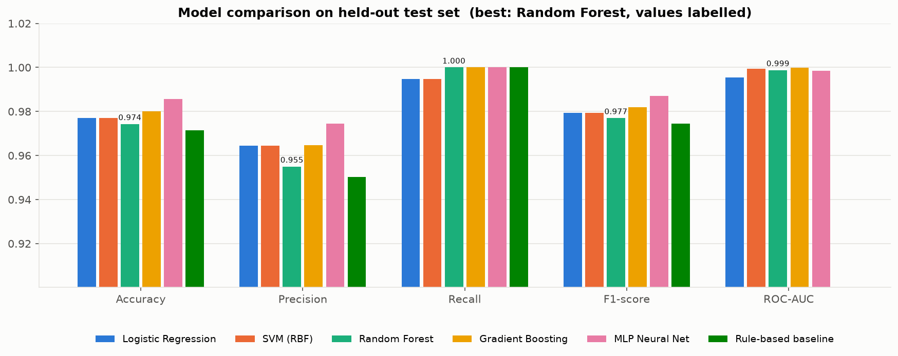
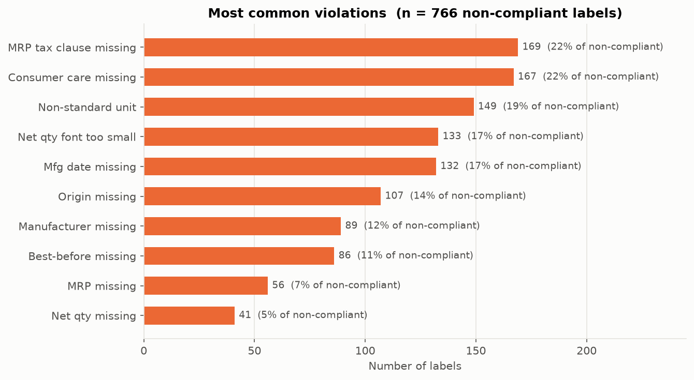
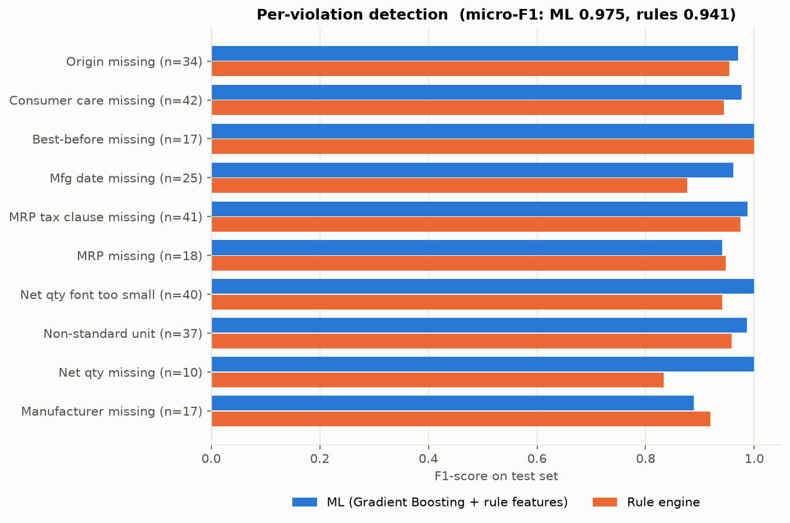

# Packaged Commodity Compliance Classification from Product Labels (SIH26034)

An end-to-end Python system that reads a packaged-product label image, extracts the
mandatory declarations with OCR, and classifies the label as **compliant / non-compliant**
with the Legal Metrology (Packaged Commodities) Rules, 2011 — also naming **which
violations** are present.

| Team member | Reg. No. |
|---|---|
| Dibyajit Choudhury | 12516706 |
| Simran Meet Singh Bali | 12518167 |

---

## 1. What the project does

> *Use a suitable product-label/image dataset containing compliant and non-compliant
> examples. Extract relevant label features, preprocess the data, and build
> classification models to identify compliance. Evaluate classification performance
> and visualize common violations.*

| Requirement | Where it is implemented |
|---|---|
| Dataset with compliant & non-compliant labels | `src/generate_dataset.py` – 1 400 annotated label images (incl. table layouts and photo-style backgrounds) (any real dataset in the same CSV format also works) |
| Preprocessing | `src/preprocess.py` – resize, projection-profile deskew, bilateral denoise, CLAHE, adaptive threshold |
| OCR | `src/ocr.py` – RapidOCR (PaddleOCR PP-OCR models on ONNX Runtime), Tesseract fallback |
| Feature extraction | `src/rules.py`, `src/features.py` – 45 engineered features + char n-gram TF-IDF/LSA of the OCR text |
| Classification models | `src/train.py` – Logistic Regression, SVM, Random Forest, Gradient Boosting, MLP vs. rule-based baseline; multi-label violation model |
| Evaluation | accuracy, precision, recall, F1, ROC-AUC, 5-fold CV, confusion matrices, per-violation F1, Hamming loss |
| Visualising common violations | `src/visualize.py` – 13 figures in `reports/figures/` + interactive Streamlit dashboard (`app.py`) |

## 2. Pipeline

```
label image ──► preprocessing ──► OCR (text + boxes) ──► line grouping
   (OpenCV)      deskew, denoise,     RapidOCR            │
                 CLAHE                                     ▼
                                     rule engine (regex + fuzzy keyword matching)
                                     • 8 mandatory declarations found?
                                     • SI unit?   • numeral height ≥ Rule 7 minimum?
                                                           │
                         45 numeric features + TF-IDF(char 2-4 grams) → SVD(60)
                                                           │
                    ┌──────────────────────────────────────┴───────────────┐
            Binary classifier                                  Multi-label classifier
      compliant vs non-compliant                         which of the 10 violations
   (best of 5 models, chosen by CV-F1)                    (Random Forest, multi-output)
```

### Mandatory declarations checked (10 violation classes)

| Code | Violation | Reference |
|---|---|---|
| MISSING_MANUFACTURER | Name & address (with PIN) of manufacturer / packer / importer missing | Rule 6(1) |
| MISSING_NET_QUANTITY | Net quantity not declared | Rule 6(1) |
| NON_STANDARD_UNIT | Net quantity in non-SI unit (gm, gms, Kgs, oz, lb, cc, fl oz) | Rule 6(1) / SI units |
| NET_QTY_FONT_TOO_SMALL | Net-quantity numerals below 1/2/4/6 mm minimum | Rule 7 |
| MISSING_MRP | Retail sale price missing | Rule 6(1) |
| MRP_TAX_CLAUSE_MISSING | MRP not declared "inclusive of all taxes" | Rule 6(1) |
| MISSING_MFG_DATE | Month & year of manufacture / packing missing | Rule 6(1) |
| MISSING_BEST_BEFORE | Best before / use-by missing | Rule 6(1) |
| MISSING_CONSUMER_CARE | Consumer care phone / e-mail missing | Rule 6(1) |
| MISSING_COUNTRY_OF_ORIGIN | Country of origin missing | Rule 6(1) |

> The rule set is a simplified academic interpretation; verify against the current gazette before real enforcement use.

### The dataset

No public dataset of Indian packaged-commodity labels annotated for Legal Metrology
compliance exists, so `generate_dataset.py` renders a realistic, fully annotated one:

* 4 categories (Food, Beverages, Personal Care, Household), 23 products, 16 fictitious brands, 6 font families,
  random layouts, colour schemes, header bands, veg-mark;
* decoy text that looks like declarations (nutrition "per 100 g", ingredients, batch no., FSSAI no.);
* 45 % compliant; non-compliant labels get 1–3 violations with realistic frequencies;
* camera-like degradation **independent of the label**: rotation ±3°, Gaussian blur, noise, brightness/contrast,
  JPEG quality 45–95 — so models must be robust to OCR errors.

Ground truth is in `data/synthetic/labels.csv` (violations, true numeral height in mm, degradation parameters).

**Using real photos:** put images in a folder with a `labels.csv` containing
`image_id, filename, compliant, violations` (violations separated by `|`, optional
`panel_width_mm`), then run `python -m src.extract_features --data-dir <folder>` and `python -m src.train`.

### Physical scale (Rule 7 font-height check)

A synthetic label is 800 px wide and represents a 100 mm panel (8 px/mm). The numeral
height is estimated from the OCR box height of the net-quantity line
(`numeral ≈ 0.68 × box height`, calibrated on the data). For a real photo, enter the
physical label width in the app sidebar (or `--panel-mm` on the CLI).

## 3. Results

| Model | Accuracy | Precision | Recall | F1 | ROC-AUC | 5-fold CV F1 |
|---|---|---|---|---|---|---|
| Logistic Regression | 0.977 | 0.965 | 0.995 | 0.979 | 0.996 | 0.975 ± 0.011 |
| SVM (RBF) | 0.977 | 0.965 | 0.995 | 0.979 | 0.999 | 0.974 ± 0.004 |
| **Random Forest** (selected) | 0.974 | 0.955 | 1.000 | 0.977 | 0.999 | 0.978 ± 0.011 |
| Gradient Boosting | 0.980 | 0.965 | 1.000 | 0.982 | 1.000 | 0.978 ± 0.009 |
| MLP Neural Net | 0.986 | 0.975 | 1.000 | 0.987 | 0.998 | 0.970 ± 0.009 |
| Rule-based baseline | 0.971 | 0.950 | 1.000 | 0.975 | — | — |

Held-out test set = 350 labels (train 1050); positive class = non-compliant.
Model selection uses 5-fold cross-validated F1 on the training set only.

**Which violations (multi-label):**

| | Micro-F1 | Macro-F1 | Hamming loss | Exact-match |
|---|---|---|---|---|
| ML (Gradient Boosting, stacked with rule features) | 0.975 | 0.971 | 0.004 | 96.3% |
| Rule engine alone | 0.941 | 0.935 | 0.010 | 92.0% |

**Common violations** (dataset): MRP tax clause missing and missing consumer-care details are the most frequent
(about 22 % of non-compliant labels each), followed by non-standard units (19 %) and too-small net-quantity numerals (17 %).

Figures (`reports/figures/`): dataset overview, violation frequency, violations per label, co-occurrence heatmap,
violation rate by category, Rule 7 font-size check, model comparison, confusion matrices, ROC curves, feature
importance, per-violation F1 (ML vs rules), actual vs predicted violations, annotated sample predictions.





> These scores are on synthetic labels. On real phone photos the system is less certain. That is why the app
> combines the ML model with the explainable rule engine and shows **NEEDS REVIEW** when they disagree.

## 4. How to run

```bash
pip install -r requirements.txt          # Python 3.10+; no Tesseract install needed
python run_pipeline.py                   # generate data → OCR → train → evaluate → plots (~22 min on 12 cores)
streamlit run app.py                     # interactive dashboard at http://localhost:8501
python -m src.predict path/to/label.jpg  # command-line check of one image (add --json for full report)
```

Useful options: `python run_pipeline.py --n 400` (faster), `--skip-generate`, `--skip-ocr` (retrain only),
`python -m src.visualize` (redraw figures).

## 5. Scanning a real product & putting it online (free)

**Why a web app and not a plain website?** The OCR and the ML models are Python and run on a server, and a static
website can't do that. Streamlit turns `app.py` into a web app that works in any phone or laptop browser.

### Scanning a real pack
1. Open the app → sidebar **Image type = 📱 Real product photo**.
2. **📁 Upload photos**: on a phone this offers *Take photo*. Upload **1–4 photos of the same pack**
   (back panel with MRP / net qty / dates, plus the panel with the manufacturer address). Declarations found
   on any of the photos count.
3. Tips: hold the pack flat, fill the frame, avoid glare/folds, one panel per photo.
4. The result is a combined verdict:
   * ✅ **COMPLIANT** / ❌ **NON-COMPLIANT**: the ML model and the rule engine agree
   * ⚠️ **NEEDS REVIEW**: they disagree, so a human should look at it (honest behaviour for unfamiliar packs)

Put the demo photos in `samples/` and the app shows a **Try the demo pack** button.

### Option A: tonight, on your laptop + phone (same Wi-Fi)
```bash
streamlit run app.py
```
Open the printed **Network URL** (e.g. `http://192.168.x.x:8501`) on the phone. Upload works and the phone offers its
camera. (The in-page 📷 Camera widget needs HTTPS, so on plain-HTTP Wi-Fi use Upload instead.)

### Option B: free public link with Streamlit Community Cloud (recommended)
1. Create a GitHub repository and push this folder (the `.gitignore` already leaves out the large generated images;
   `models/`, `reports/` and `data/processed/features.csv` are committed so the app works without retraining).
2. Go to **share.streamlit.io** → sign in with GitHub → **Create app** → pick the repo, branch `main`, file `app.py`
   → *Advanced settings* → Python 3.11 or newer → **Deploy**.
3. You get a free `https://<name>.streamlit.app` link with HTTPS, so the 📷 camera works on phones.

### Option C: Hugging Face Spaces (also free)
Create a Space → SDK **Streamlit** → upload the same files. Spaces give 16 GB RAM on the free CPU tier.

## 6. Project structure

```
SIH26034_Compliance/
├── app.py                    Streamlit dashboard (analyze / performance / violations / dataset / rules)
├── run_pipeline.py           one-command end-to-end run
├── requirements.txt
├── src/
│   ├── config.py             paths, constants, violation catalogue, Rule 7 table
│   ├── generate_dataset.py   synthetic annotated label generator
│   ├── preprocess.py         OpenCV preprocessing + image-quality features
│   ├── ocr.py                RapidOCR / Tesseract wrapper, line grouping
│   ├── rules.py              explainable rule engine (regex + fuzzy matching)
│   ├── features.py           LabelAnalyzer: image → feature vector
│   ├── extract_features.py   parallel batch OCR/feature extraction
│   ├── train.py              model training, CV, evaluation, model selection
│   ├── visualize.py          all figures
│   └── predict.py            inference (ML + rule explanations), CLI
├── data/synthetic/           images/ + labels.csv
├── data/processed/           features.csv + per-image OCR json
├── models/                   compliance_model.joblib, violation_model.joblib
└── reports/                  metrics.json, model_comparison.csv, classification_report.txt,
                              test_predictions.csv, feature_importance.csv, figures/
```

## 7. Limitations & future work

* Trained on synthetic labels; accuracy on real photographs (curved packs, glare, multilingual text) will be lower —
  fine-tune with a few hundred annotated real labels using the same CSV format.
* Only the English text of the principal display panel is analysed; Hindi/regional declarations are not parsed.
* Font-height check needs the physical panel width; a reference object or barcode could provide scale automatically.
* A CNN/vision-language model could replace the OCR + feature stage for layout-level checks.
